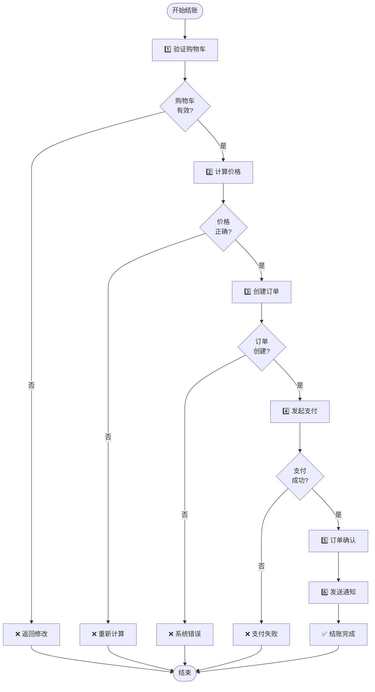
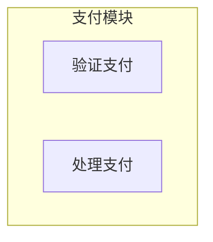
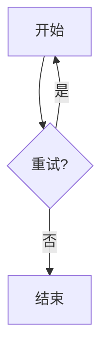
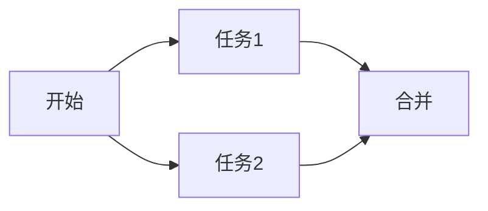

# 流程图完整指南

## 什么是流程图？

流程图（Flowchart）是用来展示**过程中的步骤和决策**的图表。

- **节点** = 过程中的各个步骤
- **箭头** = 步骤之间的流向
- **菱形** = 决策点（if/else 分支）
- **方形** = 过程/动作

---

## 📍 流程图的核心元素

### 1. 节点类型（Node Types）

| 图形 | 形状 | 代码 | 用途 |
|------|------|------|------|
| 🟢 | 圆形 | `Start([开始])` | 流程开始 |
| 📦 | 方形 | `A["步骤A"]` | 普通过程 |
| 🔷 | 菱形 | `B{条件?}` | 决策/判断 |
| 📌 | 圆形 | `End([结束])` | 流程结束 |
| ⚠️ | 方形 | `Error["❌ 错误"]` | 错误状态 |

### 2. 连接方式（Connections）

| 连接 | 代码 | 含义 |
|------|------|------|
| → | `A --> B` | 正常流向 |
| →\|标签\| | `A -->|是\| B` | 带条件的流向 |
| → | `A --> B` | 顺序执行 |

### 3. 流向方向（Flow Directions）

| 方向 | 代码 | 显示 |
|------|------|------|
| 从上到下 | `flowchart TD` | 竖向布局 ✅ 推荐 |
| 从下到上 | `flowchart BU` | 反向竖向 |
| 从左到右 | `flowchart LR` | 横向布局（宽） |
| 从右到左 | `flowchart RL` | 反向横向 |

**建议**：使用 `TD`（从上到下）可以获得最清晰的渲染效果。

---

## 🎯 实际案例：电商结账流程

### Mermaid 代码



### 流程分析

```
┌─ Start ─┐
│         │
├─ Step 1 ──┐
│ 验证购物车  │
├─ Decision 1: 有效?
│           ├─ 否 → Err1 → End
│           └─ 是 ↓
├─ Step 2
│ 计算价格
├─ Decision 2: 正确?
│           ├─ 否 → Err2 → End
│           └─ 是 ↓
├─ Step 3, 4, 5, 6
│ 继续主流程
└─ End ─┘
```

**关键特点**：
1. **主流程竖向** — 核心步骤从上到下
2. **错误路径右侧** — 错误都汇聚到 End
3. **决策分支清晰** — 每个决策有 "是/否" 标签
4. **步骤编号** — 便于理解执行顺序

---

## 💡 设计最佳实践

### ✅ 何时使用流程图

1. **业务流程** — 订单处理、用户注册、支付流程
2. **决策树** — if/else 分支、条件判断
3. **错误处理** — 多个错误路径和恢复逻辑
4. **算法** — 展示算法的执行步骤

### ✅ 设计建议

| 建议 | 原因 | 例子 |
|------|------|------|
| **使用 TD 方向** | 竖向更清晰 | `flowchart TD` |
| **限制分支深度** | 超过 3 层很复杂 | 避免深层嵌套 |
| **错误路径统一** | 便于理解 | 所有错误汇聚到结束 |
| **步骤有意义的名称** | 自文档化 | "验证购物车"而非"Check" |
| **使用编号/图标** | 增强可读性 | 1️⃣ 步骤 A, ❌ 错误 |
| **颜色编码** | 视觉区分 | 开始绿、成功蓝、错误红 |

### ❌ 常见错误

| 错误 | 改进方案 |
|------|--------|
| 使用 LR 方向 | 改用 TD（竖向） |
| 分支过多 | 分解成多个图表 |
| 节点名称过长 | 用简短的文本 + 换行 |
| 没有错误路径 | 添加异常处理分支 |
| 颜色过多 | 保持 4-5 种统一颜色 |

---

## 🎨 颜色编码规范

| 类型 | 颜色 | 十六进制 | 用途 |
|------|------|---------|------|
| 开始 | 🟢 绿 | #90EE90 | 流程开始 |
| 成功 | 🔵 蓝 | #87CEEB | 正常完成 |
| 警告 | 🟡 黄 | #FFD700 | 用户输入错误 |
| 错误 | 🔴 红 | #FF6347 | 系统错误 |
| 其他错误 | 🟠 橙 | #FFA500 | 业务逻辑错误 |
| 结束 | 🔴 粉 | #FFB6C6 | 流程结束 |

### 使用方式

```mermaid
style Start fill:#90EE90,stroke:#333,stroke-width:2px
style Success fill:#87CEEB,stroke:#333,stroke-width:2px
style Error fill:#FF6347,stroke:#333,stroke-width:1.5px
```

---

## 📊 mermaid-cli 支持的特性

### ✅ 已实现

- ✅ 所有节点类型（圆形、方形、菱形、其他）
- ✅ 多种连接方式（直线、带标签、虚线等）
- ✅ 所有流向方向（TD、LR、BU、RL）
- ✅ 自定义颜色和样式
- ✅ 中文完全支持
- ✅ PNG 输出（清晰、矢量质感）

### 🎨 视觉特征

| 元素 | 边框 | 颜色 | 填充 |
|------|------|------|------|
| 节点 | 1-2px 黑色 | 自定义 | 支持 |
| 箭头 | 2px 黑色 | 黑色 | - |
| 菱形 | 1.5px | 自定义 | 支持 |
| 文本 | - | 自定义 | - |

---

## 🔗 示例文件

- `examples/checkout_flow.mmd` — 电商结账流程（推荐）
- `examples/checkout_flow.png` — 渲染结果

---

## 📚 参考资源

- [Mermaid 官方文档](https://mermaid.js.org/syntax/flowchart.html)
- [流程图符号规范](https://en.wikipedia.org/wiki/Flowchart)

---

## 🎓 进阶技巧

### 1. 子流程（SubGraph）



### 2. 循环（Loop）



### 3. 并行（Parallel）



---

**最后更新**：2026-07-11  
**维护者**：mermaid-cli 项目团队
