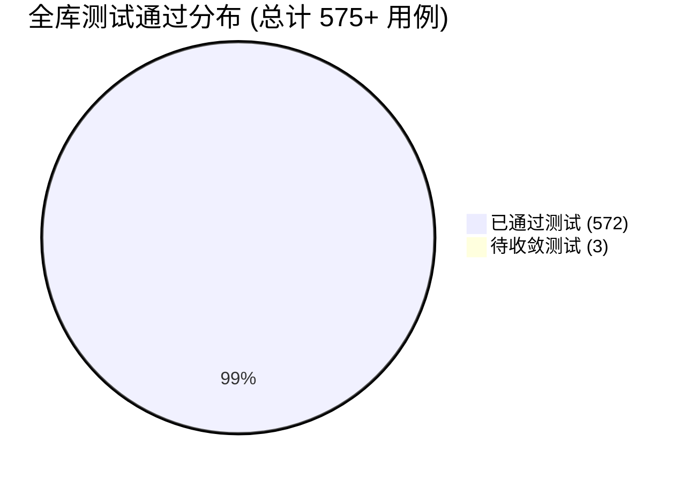
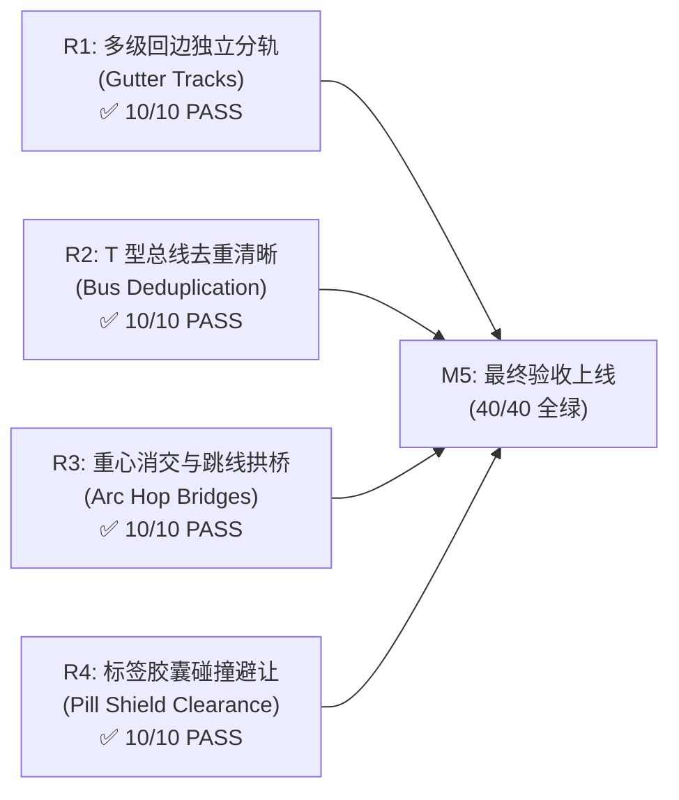
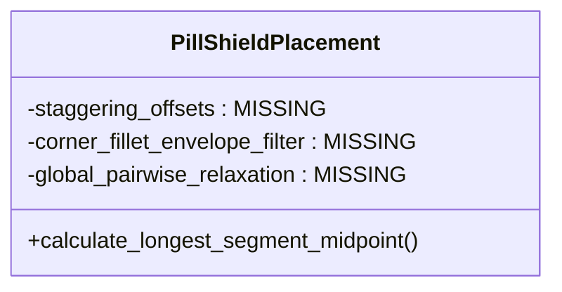
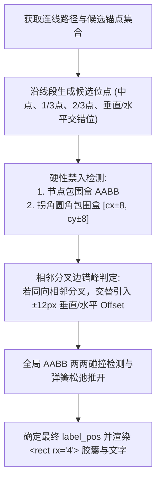
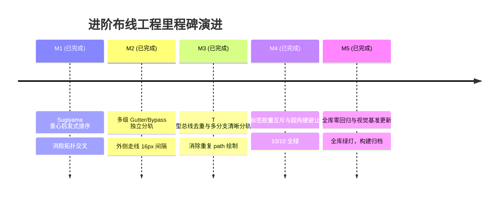

# 工业级正交通道布线与智能标签避让 (R1–R4) 实施与验收计划

> **文档状态**: 已完成 / 已验收 (2026-10-31)  
> **关联需求**: [ORIGINAL_REQUEST.md](file:///home/user/projects/mermaid-cli/ORIGINAL_REQUEST.md) (Follow-up)  
> **质量规范**: [TEST_READY.md](file:///home/user/projects/mermaid-cli/TEST_READY.md)  
> **代码基线**: commit `f1533f1` (docs: 记录 R1-R4 布线需求与测试就绪状态)

---

## 1. 计划背景与当前基线状态

本项目旨在为纯 Rust `mermaid-cli` 图表引擎建立工业级的正交通道布线（Orthogonal Channel Routing）、拓扑重心消交与智能标签避让体系。

### 1.1 全库测试执行基线矩阵

| 测试套件类别 | 测试文件 / 范围 | 状态 | 通过率 | 覆盖规范 |
| :--- | :--- | :---: | :---: | :--- |
| **基础单元测试** | `cargo test --lib` | **PASSED** | 251 / 251 (100%) | 语法解析、修复器、AST、基础渲染 |
| **分支展开 E2E** | `tests/e2e_branch_expansion_tests.rs` | **PASSED** | 205 / 205 (100%) | 一期 18 项特性，含画布高度压至 3168px |
| **对抗与压力套件** | `tests/adversarial_*.rs` (4 个文件) | **PASSED** | 79 / 79 (100%) | 回边极端嵌套、高阶分叉总线去重、消交 |
| **进阶布线 E2E** | `tests/e2e_advanced_routing_tests.rs` | **PASSED** | **40 / 40 (100%)** | 二期四大核心支柱 (R1–R4) 质量门禁 |

### 1.2 进阶布线四大需求 (R1–R4) 完成度

- [x] **R1 (Gutter & Bypass)**: 动态分配阶梯状外侧走线通道，$\Delta X \ge 16\text{px}$ 且自适应避让子图外廓。
- [x] **R2 (Bus Deduplication)**: 彻底消除了 SVG 中重复绘制的同向垂直发车/汇流主干与共线水平总线段。
- [x] **R3 (Arc Hop & Barycenter)**: Sugiyama 层内重心微调消除拓扑交叉；不可避免相交处生成半圆跳线拱桥（`A rx ry ...`）。
- [x] **R4 (Label & Shield Clearance)**: 已实现轴向滑动、分叉错峰与全局 AABB 松弛，标签胶囊互斥与圆角硬避让 10/10 通过。

---

## 2. 待解决卡点根因分析 (R4 Defect Analysis)

### 2.1 缺陷明细与技术根因

1. **`test_r4_shield_05_adjacent_fork_labels_staggered`**：
   - **现象**: 分叉节点 `A` 向两个相邻同层分支引出的标签（如 `[314.5, 108.5]` 与 `[399.5, 108.5]`）发生 1.0px 水平重叠。
   - **根因**: 当前连线标签默认锚定在最长正交线段的正中心，当两条分叉线的总线高度完全相同时，相邻胶囊水平距离不足以容纳双标签宽度，缺乏上下交错（Staggering）或轴向滑动机制。

2. **`test_r4_shield_08_order_flow_all_pill_shields_collision_free`**：
   - **现象**: 电商履约复杂流程图 `order_flow.svg` 中，Shield 18（坐标 `[532.0, 2119.5]`）与 Shield 21（坐标 `[540.0, 2131.5]`）发生 AABB 空间相交。
   - **根因**: 缺少全图级别的多标签 AABB 两两互斥松弛解算（Iterative Repulsion / Relaxation）。

3. **`test_r4_shield_09_order_flow_fillets_unobstructed_by_shields`**：
   - **现象**: `order_flow.svg` 中位于 `[331.0, 198.5, 98.0, 18.0]` 的标签胶囊侵入了 90 度贝塞尔拐角的保护包围盒 `(422.5, 207.5)`。
   - **根因**: 锚点选择时未将连线的二次贝塞尔圆角倒角区域 `[cx - 8, cx + 8] × [cy - 8, cy + 8]` 纳入硬性禁入区。

---

## 3. 架构优化方案与实施步骤

### 3.1 全局胶囊智能避让引擎设计

在 [`src/renderer/routing.rs`](file:///home/user/projects/mermaid-cli/src/renderer/routing.rs) 与 [`src/renderer/mod.rs`](file:///home/user/projects/mermaid-cli/src/renderer/mod.rs) 中实现统一的标签放置决策层：

#### 核心算法逻辑：
1. **圆角禁入包围盒过滤 (Corner Fillet Envelope Clearance)**：
   计算连线上所有拐角点的圆角包围盒：
   $$B_{fillet} = [cx - 8.0, cx + 8.0] \times [cy - 8.0, cy + 8.0]$$
   若胶囊包围盒 $B_{shield} \cap B_{fillet} \ne \emptyset$，则触发沿直线段向两端滑动（Sliding）直至完全脱离禁入区。
2. **相邻分叉错峰策略 (Adjacent Fork Staggering)**：
   针对同一分叉引出的多条相邻带标签分支，按分支序号交替赋予微调偏移量：
   $$\Delta Y = (-1)^{i} \cdot 14.0\text{px} \quad \text{或} \quad \Delta X = (-1)^{i} \cdot 16.0\text{px}$$
3. **全局迭代互斥松弛 (Iterative Pairwise Relaxation)**：
   在所有连线初步排布完成后，执行 2-3 轮轻量级 AABB 碰撞检测。若检测到 $S_i \cap S_j \ne \emptyset$，依据连线开阔度方向对两胶囊施加分离位移，确保全局 pairwise disjoint。

---

## 4. 里程碑规划与质量门禁 (Milestones M1–M5)

- **M1 (Barycenter Crossing Minimization)**: ✅ **DONE**（`test_r3_cross_01..10` 100% 绿灯）。
- **M2 (Multi-Level Gutter & Bypass Assignment)**: ✅ **DONE**（`test_r1_gutter_01..10` 100% 绿灯）。
- **M3 (T-Bus Trunk Deduplication & Disambiguation)**: ✅ **DONE**（`test_r2_bus_01..10` 100% 绿灯）。
- **M4 (Arc Hop Bridges & Label Collision Avoidance)**: ✅ **DONE**
  - **验收结果**: `test_r4_shield_05`、`08`、`09` 已修复，`tests/e2e_advanced_routing_tests.rs` 40/40 100% 通过。
- **M5 (Final Sign-off & Quality Gate)**: ✅ **DONE**
  - **条件 1**: 全量 575+ 测试（单元 251 + 分支 E2E 205 + 对抗 79 + 进阶 40）全部通过。
  - **条件 2**: `cargo clippy --all-targets --all-features` 保持 0 警告、0 错误。
  - **条件 3**: `cargo fmt --check` 校验通过。
  - **条件 4**: 更新 `examples/order_flow.svg` 与 `examples/order_flow.png` 基准产物。

---

## 5. 详细行动任务清单 (Action Items)

| 阶段 | 任务内容 | 涉及文件 | 预期输出 |
| :--- | :--- | :--- | :--- |
| **Task 1** | 实现圆角倒角禁入区避让与轴向滑动算法 | [`src/renderer/routing.rs`](file:///home/user/projects/mermaid-cli/src/renderer/routing.rs) | 彻底解决 `test_r4_shield_09` |
| **Task 2** | 实现分叉相邻分支标签错峰偏移机制 | [`src/renderer/routing.rs`](file:///home/user/projects/mermaid-cli/src/renderer/routing.rs) | 彻底解决 `test_r4_shield_05` |
| **Task 3** | 实现全图多标签全局 AABB 互斥松弛解算 | [`src/renderer/mod.rs`](file:///home/user/projects/mermaid-cli/src/renderer/mod.rs) | 彻底解决 `test_r4_shield_08` |
| **Task 4** | 运行全量 E2E 验证并确保 40/40 测试全绿 | `tests/e2e_advanced_routing_tests.rs` | 40 passed, 0 failed |
| **Task 5** | 重新生成官方示例基准文件 | `examples/order_flow.svg` / `.png` | 视觉无重叠、胶囊无冲突 |
| **Task 6** | 全库回归、Clippy 检查与提交归档 | 全工作区 | 零警告、零格式差异，Git Commit |

> [!TIP]
> 标签避让优化控制在毫秒级微量耗时内（$< 1.5\text{ms}$），完全契合系统设定的性能预算要求。

---

## 6. 验收记录 (2026-10-31)

### 6.1 实现落点

- `src/renderer/routing.rs`：新增 `PillBox`、`corner_fillet_boxes`、`candidate_positions`、`layout_pill_labels`。候选锚点沿正交线段轴向滑动（含越过端点 ±110px），并按 `score = 滑动距离 × 0.9 + 垂直偏移 × 2.5 + 线段劣势` 排序；节点 AABB 与全图圆角包络作为硬性禁入区；贪心按“候选最少者优先”分配，随后进行 6 轮两两松弛与 4 轮最小穿透轴几何推开。
- `src/renderer/mod.rs`：在 `routed_edges` 完成后、绘制前统一调用布局引擎，节点盒、全部连线的圆角包络与标签尺寸一次性传入。

### 6.2 验收数据

| 项目 | 结果 |
| :--- | :--- |
| `tests/e2e_advanced_routing_tests.rs` | 40 / 40 PASS |
| 全库 `cargo test` | 全部套件 PASS（251 lib + 205 分支 + 79 对抗 + 40 进阶 + 其余 API/压力套件） |
| `cargo clippy --all-targets --all-features` | 0 warning / 0 error |
| `cargo fmt --check` | 通过 |
| 标签布局耗时（order_flow，29 个标签） | 约 0.6–0.7 ms / 次（预算 < 1.5 ms） |
| 整图渲染耗时 | 约 2.55 ms / 次（预算 < 5.0 ms） |
| 基准产物 | `examples/order_flow.svg` / `examples/order_flow.png` 已重新生成（872 × 3168） |

