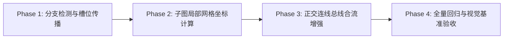

# 🚀 研发计划规范：同层分叉节点横向并行展开体系

> **项目目标**：在纯 Rust 原生流程图布局引擎中，实现业务决策分流与并行任务（Fork-Join）的**横向多列独立泳道展开与子图局部自适应网格**。  
> **核心指标**：将复杂流程图（如全链路履约流程）纵向高度压缩 **35%~40%**（从 4785px 降至约 3000px），呈现工整清晰的现代化并行分支美学。

---

## 目录
1. [架构现状与升级总览](#一架构现状与升级总览)
2. [算法设计与数学模型](#二算法设计与数学模型)
3. [核心模块变动与工程分工](#三核心模块变动与工程分工)
4. [四阶段实施路线图 (Milestones)](#四四阶段实施路线图-milestones)
5. [质量保障与回归验证标准](#五质量保障与回归验证标准)

---

## 一、架构现状与升级总览

### 1.1 现状瓶颈与成因
```
当前机制 (全局居中 + 中轴坍缩):
          [ C2: 选择支付方式 ] (Layer L)
             ╱             ╲
   [ C3: 在线支付 ]     [ C9: 货到付款 ] (Layer L+1, 2个节点水平排开)
         ↓
   [ C4: 回调结果 ]  (Layer L+2, 仅1个节点被强制拉回全图几何中轴 X=400!)
         ↓
   [ C5: 已支付 ]
```
- **问题 1：中轴强制坍缩（Center Collapse）**：每一层仅根据当前层节点数量独立做全局居中，导致下游单节点失去其所属分支的几何对齐，左右摇摆。
- **问题 2：长短支路不平衡（Branch Imbalance）**：短分支（如 C9）结束后，后续 3 层全为大片空白死区，导致整体纵深被无限拉长。

### 1.2 目标架构（泳道化列槽位 + 子图局部网格）
```
目标效果 (并行泳道展开 + 局部网格自适应):
             [ C2: 选择支付方式 ]
             ┌───────┴───────┐
       (Lane -1: 左列)  (Lane +1: 右列)
      [ C3: 在线支付 ]   [ C9: 货到付款 ]
             ↓                 │
      [ C4: 回调结果 ]          │ (保持右列通道，不发生中轴坍缩)
             ↓                 │
      [ C5: 状态已支付 ]       │
             └───────┬─────────┘
                     ↓
             [ D1: 仓储调度决策 ] (合流汇聚)
```

---

## 二、算法设计与数学模型

### 2.1 分叉识别与泳道槽位传播算法 (Fork Detection & Slot Propagation)

1. **分叉识别（Fork Identification）**：
   - 遍历 DAG 图中所有节点，检索其前向出度 $\text{out\_degree}(u) \ge 2$ 的分叉节点（如菱形决策判定、并行网关）；
   - 对 $u$ 的所有前向出边 $e_1, e_2, \dots, e_k$，按其连线语义或定义顺序，为各个目标节点分配初始泳道相对偏移值：
     $$\text{slot\_index} \in \left\{ -\frac{k-1}{2}, \dots, 0, \dots, \frac{k-1}{2} \right\}$$
     例如：二分叉为 $\{-0.5, +0.5\}$，三分叉为 $\{-1.0, 0, +1.0\}$。

2. **分支单调传播（Lane Propagation）**：
   - 沿着 DAG 拓扑前向搜索，将分配的 `slot_index` 递归赋给该分支下的所有后继节点；
   - **合流阻断规则（Join Termination）**：当后继节点的入度 $\text{in\_degree}(v) \ge 2$（合流节点，如最终的仓储调度、售后统一流）时，阻断传播，泳道槽位偏移重置为 $0$（回归局部中轴）。

### 2.2 跨层虚拟锚点占位（Virtual Lane Anchors）

针对短分支（如只有 1 个节点的 `C9`）：
- 计算同一分叉下各分支的最长深度：$D_{max} = \max(\text{depth}(B_1), \text{depth}(B_2), \dots)$；
- 若分支 $B_i$ 提前终结，在缺失的中间层记录虚拟占位标志（`LaneReservation`）；
- 防止长分支的节点横向漂移侵占空闲列，保证后续正交走线直上直下，无交叉穿插。

### 2.3 子图局部坐标系（Subgraph-Scoped Local Grid）

改变“全图单一全局居中”的模式，引入层次化容器布局：
```
1. 阶段级布局 (Phase Level):
   - 计算各 Subgraph 的拓扑层级（第 1 阶段、第 2 阶段...）；
   - 各 Subgraph 作为独立外接卡片垂直堆叠。

2. 子图级布局 (Subgraph Level):
   - 子图根据内部最大并行泳道数 $M$ 自适应计算所需宽度：
     $$W_{sg} = M \times W_{node} + (M - 1) \times S_{h} + 2 \times P_{sg}$$
   - 节点 $X$ 坐标直接绑定其所属泳道槽位：
     $$X_{node} = X_{sg\_center} + \text{slot\_index} \times (W_{node} + S_{h})$$
```

---

## 三、核心模块变动与工程分工

```
src/renderer/
├── mod.rs              # 调度中心：接入子图局部坐标系分配
├── layout/             # 🌟 新增：独立分层排版子模块
│   ├── mod.rs          # 布局器接口定义
│   ├── branch.rs       # 🌟 新增：分叉检测、泳道槽位传播与合流分析
│   └── grid.rs         # 🌟 新增：子图局部列网格与坐标映射
├── routing.rs          # 正交连线路由器：支持总线合流（Bus Join）与跨泳道避障
└── theme.rs            # CSS 变量主题引擎（已就绪）
```

### 数据结构定义草案 (`src/renderer/layout/branch.rs`)

```rust
#[derive(Debug, Clone)]
pub struct BranchLane {
    /// 所属分支唯一标识
    pub branch_id: usize,
    /// 泳道水平槽位相对偏移量（-1.0=极左, 0.0=居中, +1.0=极右）
    pub slot_offset: f32,
    /// 该泳道覆盖的节点集合
    pub nodes: HashSet<String>,
    /// 该泳道所占据的层级范围 (min_depth, max_depth)
    pub depth_span: (usize, usize),
}

pub struct BranchAnalyzer {
    pub lanes: Vec<BranchLane>,
    pub node_to_lane: HashMap<String, usize>,
    pub join_nodes: HashSet<String>,
}
```

---

## 四、四阶段实施路线图 (Milestones)



### Phase 1：分支检测与槽位传播算法 (第 1 周)
- **交付物**：`src/renderer/layout/branch.rs`
- **内容**：
  - 构建 DAG 分叉检测器，识别出度 $\ge 2$ 的分叉源节点；
  - 实现从分叉源到合流点的泳道槽位自动分配与递归传递；
  - 编写算法单元测试（覆盖 2 分叉、3 分叉、多重嵌套分叉及环路场景）。

### Phase 2：子图局部网格坐标计算 (第 2 周)
- **交付物**：`src/renderer/layout/grid.rs` 与 `src/renderer/mod.rs` 改造
- **内容**：
  - 子图内部根据泳道数量自适应扩展宽度（不影响子图外部的中轴对齐）；
  - 节点坐标按其泳道槽位计算，彻底消除同一分支下游节点“被拉回全图几何中轴”的坍缩现象；
  - 消除短分支下方的空白断层。

### Phase 3：正交连线总线合流增强 (第 3 周)
- **交付物**：`src/renderer/routing.rs` 升级
- **内容**：
  - 增强 `route_orthogonal_edge` 对并行多列的适配；
  - 针对并行分叉输出“T型分发总线”；针对汇聚合流输出“T型汇流总线”；
  - 保持圆角正交倒角（$r=8\text{px}$）与文本胶囊遮罩。

### Phase 4：全量回归与视觉基准验收 (第 4 周)
- **交付物**：视觉基准产物 + 全量测试报告
- **内容**：
  - 针对电商全链路履约用例进行渲染，对比整图尺寸与高度压缩率（预期高度由 4785px 降至 3000px 左右）；
  - 执行 `cargo test --all-features`，确保现有 330 项测试与 snapshot 测试全部保持通过。

---

## 五、质量保障与回归验证标准

1. **零回归原则（Zero Regression）**：
   - 现有的所有 23 种图表语法、单链流程图、时序图、状态图等输出必须保持 100% 正常。
2. **性能预算约束（Performance Budget）**：
   - 布局计算时间增量必须控制在 **< 2ms** 以内，单图整体渲染维持在毫秒级水准。
3. **视觉验收对比清单**：
   - [ ] 支付子图（G3）内，“在线支付”与“货到付款”分列左右两列并行下行；
   - [ ] 仓储子图（G4）内，“本地仓有货”与“采购调拨”分列下行；
   - [ ] 售后子图（G5）内，“退货”与“换货”分列下行；
   - [ ] 所有并行线段拐角保持圆角平滑，文字遮罩无错位。
