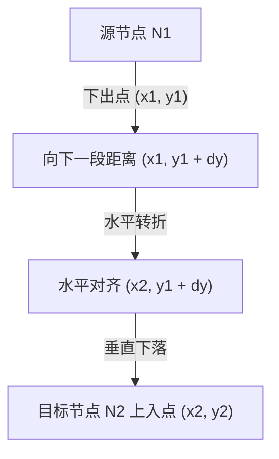

# 📐 架构增强规划规范：借鉴 Ondine 现代渲染与样式体系

> **参考基准**：[Ondine (ondine.sh)](https://ondine.sh/) by WEVM  
> **核心目标**：将 `mermaid-cli` 的渲染视觉与前端集成体验提升至现代工业级水准，引入 **CSS 变量动态主题** 与 **圆角正交连线路由算法**。

---

## 目录
1. [项目背景与目标对比](#一项目背景与目标对比)
2. [特性 1：CSS 变量动态主题系统 (Dynamic Theming via CSS Custom Properties)](#二特性-1css-变量动态主题系统)
3. [特性 2：圆角正交连线路由算法 (Rounded Orthogonal Routing with Fillets)](#三特性-2圆角正交连线路由算法)
4. [工程架构变动与模块划分](#四工程架构变动与模块划分)
5. [实施阶段与路线图 (Implementation Roadmap)](#五实施阶段与路线图)
6. [质量保障与回归验证标准](#六质量保障与回归验证标准)

---

## 一、项目背景与目标对比

### 1.1 现状分析与痛点
- **静态颜色固化**：目前 `mermaid-cli` 输出的 SVG 中直接内联硬编码十六进制颜色（如 `fill="#ffffff" stroke="#334155"`）。当文档系统或现代 Web 框架（如 VitePress、Next.js、Docusaurus）在亮色与暗色模式间切换时，无法通过 CSS 变量动态响应，必须重新调用编译器执行昂贵的重绘。
- **连线路径生硬**：目前的连线路由部分使用直接三次贝塞尔曲线或折线，在多层分支、跨阶段反馈和并行动线较多时，容易出现斜向交叉贯穿、割裂中间节点或视觉杂乱的问题。

### 1.2 Ondine 的借鉴价值
- **Ondine (ondine.sh)** 采用 `--ondine-*` CSS 变量体系，SVG 内部组件全部绑定变量并带 fallback，实现 **0 编译开销的暗黑模式即时无缝切换**。
- **圆角正交路由（Rounded Orthogonal Routing）**：连线严格遵循正交网格（仅水平与垂直线段），并在所有 90 度拐角处做平滑圆角倒角（Fillet Radii），视觉极其工整、干净、具备工业质感。

---

## 二、特性 1：CSS 变量动态主题系统

### 2.1 CSS 变量命名规范定义

定义统一且语义明确的 CSS 变量前缀 `--mermaid-*`：

```css
:root {
  /* 基础画布与背景 */
  --mermaid-bg: transparent;
  --mermaid-font-family: 'Inter', system-ui, -apple-system, sans-serif;

  /* 节点基础样式 */
  --mermaid-node-bg: #ffffff;
  --mermaid-node-border: #334155;
  --mermaid-node-border-width: 1.5px;
  --mermaid-node-border-radius: 6px;

  /* 文字颜色 */
  --mermaid-text-primary: #0f172a;
  --mermaid-text-muted: #64748b;

  /* 连线与箭头 */
  --mermaid-edge-stroke: #94a3b8;
  --mermaid-edge-width: 1.5px;
  --mermaid-arrowhead-fill: #94a3b8;

  /* 连线文本防遮挡胶囊底衬 */
  --mermaid-pill-bg: #ffffff;
  --mermaid-pill-border: #e2e8f0;

  /* 子图分组 */
  --mermaid-subgraph-bg: rgba(248, 250, 252, 0.7);
  --mermaid-subgraph-border: #cbd5e1;
  --mermaid-subgraph-title: #334155;

  /* 语义化状态类 (与 classDef 映射) */
  --mermaid-terminal-bg: #1f77b4;
  --mermaid-decision-bg: #fff3cd;
  --mermaid-process-bg: #e7f1ff;
  --mermaid-danger-bg: #f8d7da;
  --mermaid-success-bg: #d4edda;
}

/* 自动响应系统深色模式 */
@media (prefers-color-scheme: dark) {
  :root {
    --mermaid-node-bg: #1e293b;
    --mermaid-node-border: #475569;
    --mermaid-text-primary: #f8fafc;
    --mermaid-text-muted: #94a3b8;
    --mermaid-edge-stroke: #64748b;
    --mermaid-arrowhead-fill: #64748b;
    --mermaid-pill-bg: #0f172a;
    --mermaid-pill-border: #334155;
    --mermaid-subgraph-bg: rgba(15, 23, 42, 0.6);
    --mermaid-subgraph-border: #334155;
    --mermaid-subgraph-title: #94a3b8;
  }
}
```

### 2.2 双重兜底（Dual Fallback）与光栅化兼容性
为确保 **resvg** 原生导出 PNG/PDF 时不受影响（某些光栅化器对 CSS 变量求值有限），SVG 输出必须采用 CSS 规范的标准回退语法：
```xml
<!-- 节点矩形示例 -->
<rect x="100" y="50" width="160" height="48" rx="6"
  style="fill: var(--mermaid-node-bg, #ffffff); stroke: var(--mermaid-node-border, #334155); stroke-width: var(--mermaid-node-border-width, 1.5px);"/>

<!-- 连线路径示例 -->
<path d="M 180 98 L 180 140"
  style="fill: none; stroke: var(--mermaid-edge-stroke, #94a3b8); stroke-width: var(--mermaid-edge-width, 1.5px);"/>
```
> [!NOTE]
> 这种双重语法在浏览器端优先由宿主站点的 CSS 变量驱动；在无头 CLI `resvg` 光栅化为 PNG 时，自动取逗号后面的十六进制常量作为真实像素值，兼顾动态性与光栅化稳定性。

### 2.3 CLI 参数与配置模式
- 增加 CLI 选项 `--css-variables`（布尔值，默认开启智能模式）。
- 当指定 `-t dark` 或 `-t forest` 等传统静态主题时，若未启用 `--css-variables`，则直出纯静态色值以保证旧版兼容。

---

## 三、特性 2：圆角正交连线路由算法

### 3.1 几何模型与线段正交化 (Orthogonal Path Routing)

在有向图或状态图中，两节点 $N_1$ 与 $N_2$ 的连接线按以下规则进行 Manhattan 正交化：



#### 规则定义：
1. **主轴方向约束**：
   - `TD`（自上而下）：出点必须在源节点底边中点或底侧插槽；入点必须在目标节点顶边中点或顶侧插槽。
   - `LR`（自左向右）：出点在右侧，入点在左侧。
2. **避障通道（Gutter Routing）**：
   - 当跨层连接或向上回环（Back-edge）时，折线向外侧避让通道延伸（外扩 24px），不穿过任何中间同层节点的包围盒 $[x_{min}, x_{max}, y_{min}, y_{max}]$。

### 3.2 平滑圆角倒角算法 (Fillet Corner Smoothing)

所有 $90^\circ$ 转角处（如从垂直转向水平、水平转向垂直），利用贝塞尔二次曲线（Quadratic Bézier `Q`）或者圆弧（Arc `A`）实现平滑过渡，倒角半径设为 $r = 6\text{px}$（当折线线段长度不足时自适应缩小为 $r = \min(6, \frac{len}{2})$）。

#### SVG 路径生成逻辑伪代码：
```rust
pub fn generate_rounded_orthogonal_path(waypoints: &[(f32, f32)], radius: f32) -> String {
    if waypoints.len() < 2 { return String::new(); }
    let mut d = format!("M {:.1} {:.1}", waypoints[0].0, waypoints[0].1);
    
    for i in 1..waypoints.len() - 1 {
        let p_prev = waypoints[i - 1];
        let p_curr = waypoints[i];
        let p_next = waypoints[i + 1];
        
        // 计算拐点前后的切点
        let v_in = normalize(p_curr - p_prev);
        let v_out = normalize(p_next - p_curr);
        let actual_r = radius.min(dist(p_prev, p_curr) / 2.0).min(dist(p_curr, p_next) / 2.0);
        
        let start_fillet = p_curr - v_in * actual_r;
        let end_fillet = p_curr + v_out * actual_r;
        
        // 绘制直到倒角起始点的直线，然后做圆滑转弯
        d.push_str(&format!(" L {:.1} {:.1}", start_fillet.0, start_fillet.1));
        d.push_str(&format!(" Q {:.1} {:.1} {:.1} {:.1}", p_curr.0, p_curr.1, end_fillet.0, end_fillet.1));
    }
    
    let last = waypoints.last().unwrap();
    d.push_str(&format!(" L {:.1} {:.1}", last.0, last.1));
    d
}
```

### 3.3 标签胶囊遮罩居中定位 (Pill Shield Positioning)
- 连线文本（如 `-->|"高危 ≥ 80"|`）定位在最长水平或垂直骨干段的正中；
- 文本下方自动渲染 `<rect rx="4" style="fill: var(--mermaid-pill-bg, #ffffff); stroke: var(--mermaid-pill-border, #e2e8f0);"/>`；
- 正交线在胶囊背后穿过时保持被遮挡，绝不发生文字与折线重叠穿插。

---

## 四、工程架构变动与模块划分

```
src/
├── renderer/
│   ├── mod.rs                  # 渲染调度中心
│   ├── routing.rs              # 🌟 新增：圆角正交路径规划器与拐点倒角算法
│   ├── theme.rs                # 🌟 新增：CSS 变量主题注册表与回退计算器
│   └── ...
├── svg/
│   ├── mod.rs                  # SvgBuilder 增强：支持带有 style 变量属性的注入
│   └── ...
└── config/
    └── mod.rs                  # 新增 css_variables 配置支持
```

---

## 五、实施阶段与路线图

| 阶段 | 周期 | 核心交付物 | 达成目标 |
| :--- | :--- | :--- | :--- |
| **Phase 1** | 第 1 周 | `src/renderer/theme.rs` + `SvgBuilder` 适配 | SVG 全面支持 `--mermaid-*` CSS 变量输出与 resvg 十六进制兜底 |
| **Phase 2** | 第 2 周 | `src/renderer/routing.rs` 正交路由器 | 流程图全面启用圆角正交路径（Manhattan + Fillet Smoothing），消除杂乱斜线 |
| **Phase 3** | 第 3 周 | 官方网站 & Playground Studio 联动 | 官网与交互实验室接入暗黑/浅色模式即时切换（零编译延迟验证） |
| **Phase 4** | 第 4 周 | 330+ 测试用例全量回归与视觉基准对比 | 建立针对 Ondine 风格的视觉对比测试集并确保 0 回归 |

---

## 六、质量保障与回归验证标准

1. **现有测试 0 破坏**：运行 `cargo test --all-features`，现有的 330 项单元测试与集成测试必须 100% 通过。
2. **光栅化一致性**：PNG / PDF 渲染在缺少浏览器 CSS 引擎的环境下，依然使用内置 fallback 呈现高保真像素。
3. **视觉对齐验证**：使用 `examples/order_flow.mmd`、`examples/checkout_flow.mmd` 进行前后视觉对比，证明拐角平滑且无穿模遮挡。
