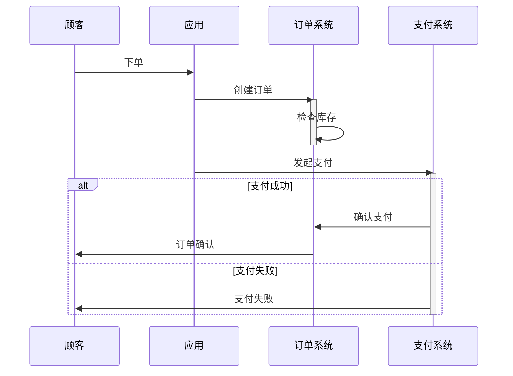

# 时序图完整指南

## 什么是时序图？

时序图（Sequence Diagram）是用来展示**对象之间如何按时间顺序进行交互**的图表。

- **竖向** = 时间轴（向下表示时间流逝）
- **横向** = 不同的参与者（对象、系统、服务）
- **箭头** = 消息交互（函数调用、数据传递）

---

## 📍 时序图的核心元素

### 1. 参与者（Participant）

```
participant Customer as 顾客
participant App as 应用
```

**显示效果**：
```
┌─────┐      ┌────┐
│ 顾客 │      │ 应用 │
└─────┘      └────┘
  │            │
  │(时间线)    │(时间线)
  │            │
  ↓            ↓
```

**用途**：
- ✅ 标识系统中的各个角色/服务
- ✅ 显示参与者之间的通信关系

### 2. 消息（Message）

```mermaid
Customer->>App: 发送消息
App-->>Customer: 返回消息
```

**箭头类型**：

| 符号 | 含义 | 代码 |
|------|------|------|
| `→` | 同步消息（实线） | `A->>B` |
| `⇢` | 异步消息（虚线） | `A-->>B` |
| `←` | 返回消息（点线） | `B--)A` |
| `✕` | 跨消息（带叉） | `A-xB` |

**用途**：
- ✅ 显示参与者之间的通信
- ✅ 标记消息的方向和类型

### 3. 激活框（Activation Box）

```mermaid
activate Warehouse
Warehouse->>Delivery: 交付快递
deactivate Warehouse
```

**显示效果**：

```
┌─────────┐
│  Warehouse 活跃
│    │
│    ├→ 交付快递
│    │
│  Warehouse 停止活跃
└─────────┘
```

**用途**：
- ✅ 表示参与者在某个时间段处于**活跃状态**
- ✅ `activate` = 开始工作，`deactivate` = 停止工作
- ✅ 显示参与者何时忙碌（如处理订单、打包商品）

**视觉特征**：
- 小矩形框（灰色填充）
- 宽度固定，长度表示活跃时长
- 在参与者的生命线上标记

### 4. 条件框（Condition Block / Alt-Else）

```mermaid
alt 支付成功
    Payment->>Order: 确认支付
else 支付失败
    Payment->>Customer: 支付失败
end
```

**显示效果**：

```
┌─────────────────────────────┐
│ alt [支付成功]              │
│   │                         │
│   ├─ Payment→Order          │
│   │                         │
├─────────────────────────────┤  ← 分隔线
│ else [支付失败]             │
│   │                         │
│   ├─ Payment→Customer       │
│   │                         │
└─────────────────────────────┘
```

**用途**：
- ✅ 显示**可选的交互路径**
- ✅ `alt` = 如果条件成立，`else` = 否则
- ✅ 表示**业务分支逻辑**

**视觉特征**：
- 大矩形框（包含两条分支）
- 上部标注条件（`alt [...] / else [...]`）
- 内部用横线分隔两条分支
- 横跨所有参与者

### 5. 其他块类型

| 块类型 | 用途 | 代码 |
|--------|------|------|
| `opt` | 可选交互 | `opt 条件` |
| `loop` | 循环 | `loop` |
| `par` | 并行 | `par` |
| `break` | 中断 | `break` |

---

## 🎯 实际案例：电商购物流程

### Mermaid 代码



### 元素解析

1. **顾客 → 应用**（第一条消息）
   - 顾客点击"下单"
   - 消息类型：实线箭头（同步调用）

2. **应用 → 订单系统**（创建订单）
   - 应用请求系统创建订单
   - 消息类型：实线箭头

3. **激活框（Order）**
   - `activate Order` = 订单系统开始工作
   - 内部操作：检查库存（自己调自己 `Order->>Order`）
   - `deactivate Order` = 订单系统停止工作

4. **应用 → 支付系统**（发起支付）
   - 应用调用支付服务
   - `activate Payment` = 支付系统开始处理

5. **条件框（Alt-Else）**
   ```
   ┌─────────────────────────────┐
   │ alt [支付成功]              │
   │   Payment → Order           │
   │   Order → Customer          │
   ├─────────────────────────────┤
   │ else [支付失败]             │
   │   Payment → Customer        │
   └─────────────────────────────┘
   ```
   - 两条业务分支
   - 基于支付结果执行不同的后续操作

6. **`deactivate Payment`**
   - 支付系统停止工作

---

## 💡 设计最佳实践

### ✅ 何时使用时序图

1. **业务流程** — 展示完整的工作流程
2. **系统交互** — 显示系统之间如何协作
3. **异常处理** — 用 `alt/else` 显示错误路径
4. **实时通信** — 消息驱动的架构

### ✅ 设计建议

| 建议 | 原因 |
|------|------|
| **保持简洁** | 超过 15 个参与者会很拥挤 |
| **分层处理** | 复杂流程分成多个图表 |
| **标记关键点** | 用激活框标记关键操作 |
| **使用条件块** | 清晰表示分支逻辑 |
| **有意义的消息** | 消息标签要说明动作 |

### ❌ 常见错误

| 错误 | 改进方案 |
|------|--------|
| 参与者过多 | 分解为多个图表 |
| 消息标签不清晰 | 用动词短语（如"检查库存"而非"check"） |
| 条件框过深 | 最多 2-3 层嵌套 |
| 忽略激活框 | 用 activate/deactivate 标记工作周期 |

---

## 📊 mermaid-cli 支持的特性

### ✅ 已实现

- ✅ 参与者定义和标签
- ✅ 各类消息箭头（实线、虚线、点线）
- ✅ 激活框（Activation Box）
- ✅ 条件块（Alt-Else）
- ✅ 其他块类型（Opt, Loop, Par, Break）
- ✅ 中文完全支持
- ✅ PNG 输出（1.5px 边框，清晰可读）

### 🎨 视觉改进

| 元素 | 边框宽度 | 颜色 | 特点 |
|------|---------|------|------|
| 参与者框 | 1px | 黑色 | 圆角 |
| 消息 | 2px | 黑色 | 实线/虚线/点线 |
| 激活框 | 1.5px | #999 | 浅灰填充 |
| 条件框 | 1.5px | #666 | 标签+分隔线 |

---

## 🔗 示例文件

- `examples/oa_reimbursement_flow.mmd` — OA 财务系统发票报销
- `examples/shopping_sequence.mmd` — 电商购物流程

---

## 📚 参考资源

- [Mermaid 官方文档](https://mermaid.js.org/syntax/sequenceDiagram.html)
- [UML 时序图规范](https://en.wikipedia.org/wiki/Sequence_diagram)

---

**最后更新**：2026-07-11  
**维护者**：mermaid-cli 项目团队
